<div align="center">



<table>
  <tr>
    <td></td>
    <td></td>
    <td></td>
  </tr>
</table>

</div>


## `▓ OPERATIVE DOSSIER ▓`


```diff
+ NAME ............ Maksud
+ CALLSIGN ........ Efficiency300
+ DIVISION ........ Backend / Python / FastAPI
+ SECTOR .......... Tashkent
+ SIDE JOBS ....... ASCII generators, Telegram bots, itch.io games
- SLEEP ........... not found
- MERCY ........... deprecated since v0.0.1
! STATUS .......... ACTIVE — accepting contracts
```

> *"Your code is a commodity. Your uptime is a commodity. You are a commodity."*
> — orientation pamphlet, page 1

<br clear="both" />


## `▓ ARSENAL ▓`

<div align="center">


<br/>

<br/>


</div>


## `▓ PERFORMANCE REVIEW ▓`

<div align="center">


<br/>


</div>


## `▓ CONTACT YOUR HANDLER ▓`

<div align="center">

<a href="mailto:maksud.jumaniyozov21@gmail.com"></a>
<a href="https://www.linkedin.com/in/maksudbek-jumaniyozov-34a831318/"></a>
<a href="https://efficiency300.itch.io/"></a>
<a href="https://t.me/diabl0l666"></a>


</div>


<div align="center">

<sub>`// THIS PROFILE IS PROPERTY OF THE CORPORATION. UNAUTHORIZED EMPATHY WILL BE PROSECUTED.`</sub>

</div>
